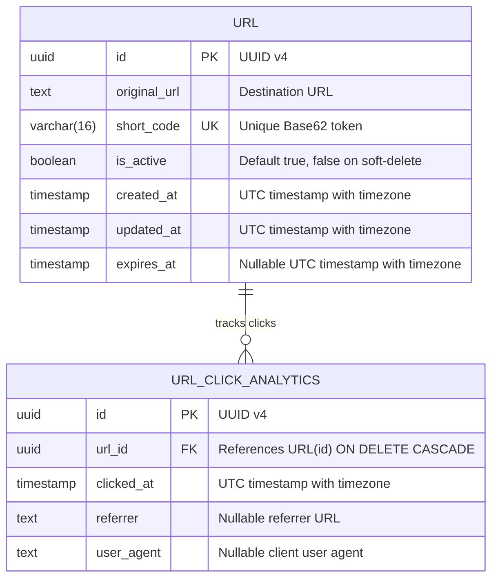

# Database Design & Modeling

## PostgreSQL Database Schema

The database follows a normalized relational structure optimized for high-read URL redirection and time-series click tracking.

### Entity-Relationship Diagram

### Table Definitions

#### `urls`
- `id`: UUID primary key.
- `original_url`: TEXT, destination HTTP/HTTPS URL.
- `short_code`: VARCHAR(16), unique Base62 token.
- `is_active`: BOOLEAN, soft-deletion status indicator.
- `created_at`: TIMESTAMPTZ, creation timestamp in UTC.
- `updated_at`: TIMESTAMPTZ, last update timestamp in UTC.
- `expires_at`: TIMESTAMPTZ, nullable expiration date.

#### `url_click_analytics`
- `id`: UUID primary key.
- `url_id`: UUID foreign key referencing `urls(id)` with cascading delete.
- `clicked_at`: TIMESTAMPTZ, timestamp of redirect request in UTC.
- `referrer`: TEXT, HTTP `Referer` header value (sanitized).
- `user_agent`: TEXT, HTTP `User-Agent` header value (sanitized).

### Indexing Strategy
1. **`urls(short_code)` UNIQUE**: B-tree index for O(1) URL lookups.
2. **`urls(created_at)`**: Chronological sorting and administrative paging.
3. **`urls(is_active, expires_at)`**: Compound index accelerating active URL filtering.
4. **`url_click_analytics(url_id)`**: B-tree index supporting fast click count aggregation.
5. **`url_click_analytics(clicked_at)`**: Time-series filtering and historical metrics.

